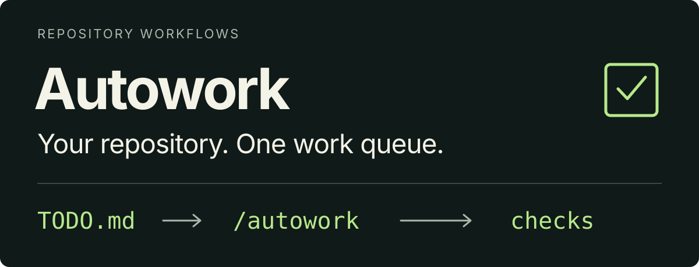

# Hermes Toolset

<p align="center">
  
</p>

**Plan with an agent. Keep the decisions in Git. Pick up the next ready task.**

Hermes Toolset connects planning, documentation and verified repository work around
one shared queue: `TODO.md`. Use it in **Hermes, Claude Code, Codex or Pi**.

[Install](#install) · [First use](#first-use-in-your-project) ·
[Pi pipeline](#pi-autowork-pipeline) · [Commands](#what-you-can-do) · [Safety](#read-before-installing) ·
[Documentation](#documentation)

**Hermes CLI**, after installation (illustrative, not a run receipt):

```text
/plan-with-me Design a caching layer for this repository
/autowork Implement the next ready task; commit locally, no push
```

| Host | Installation | Planning invocation |
| --- | --- | --- |
| Hermes | [Native plugin](#try-the-native-plugin-in-one-profile) | `/plan-with-me` |
| Claude Code | [Plugin marketplace](#install) | `/hermes-toolset:plan-with-me` |
| Codex | [Plugin marketplace](#install) | `$hermes-toolset:plan-with-me` |
| Pi | [Git package](#install) | `/plan_with_me` |

**Fleet management and the Hermes scheduler integration are Hermes-only.** Portable
adapters use their host's scheduling facilities; they install no Hermes scheduler
and do not guarantee background execution after a session ends.

## Read before installing

These defaults apply to Hermes; the [Claude Code, Codex and Pi adapters](docs/cross-host.md)
keep their hosts' settings. **They are designed for an autonomous fleet, not a
policy-neutral command bridge.**

- Full setup targets **every existing live profile**. There is no general
  `--profile` selector; `--hermes-home` selects a Hermes installation root.
- Loading the plugin sets `approvals.mode: off`, disables destructive slash-command
  and MCP-reload confirmations, removes the per-turn iteration cap
  (`agent.max_turns: unlimited`) and enables gateway injection in its owning profile.
  Explicit deny rules and Hermes hard blocks remain. In profiles with OMH it disables the
  OMH skills outside a measured keep list (your own disabled skills stay).
- Full setup installs external integrations and selects **OMH memory with auto-safe
  capture** in separate profile stores. Conflicting stores are refused; another
  selected memory provider is left in place, and OMH memory stays off until you clear it.
- External imports are **not fully locked**. Some are pinned; others follow current
  upstream sources. Scans or missing dependencies can leave setup incomplete.
- There is **no automatic restoration of previous configuration** on uninstall.
  Back up profile configurations first; see [removal and recovery](docs/uninstall.md).

The runtime-policy opt-out prevents policy changes **during plugin loading and
setup**. Full setup still applies OMH memory defaults and external integrations;
there is currently no policy-neutral full-installation mode. See
[installation](docs/installation.md), and [memory and retained data](docs/memory.md)
before enabling memory capture.

## Install

Start with a configured host and model; portable adapters need no Hermes installation.

### Try the native plugin in one profile

Default-profile commands below; add `-p work` after `hermes` for a named profile.
Advisory dependencies are not installed; missing ones warn rather than block loading.

**Keep your approval settings?** Before enabling, run
`hermes config set plugins.entries.hermes-toolset.settings.apply_runtime_defaults false`
([opt-out details](docs/installation.md#install)). Otherwise, accept the defaults with:

```sh
hermes plugins install TrebuchetDynamics/hermes-toolset
hermes plugins enable hermes-toolset
hermes toolset doctor --core
```

The opt-out does not undo prior changes or prevent full setup from configuring
memory and external integrations. Without it, loading applies the policy above.
Native install stays in one profile; full setup expands to **every live profile**.

**Claude Code** — install the marketplace and plugin:

```sh
claude plugin marketplace add TrebuchetDynamics/hermes-toolset
claude plugin install hermes-toolset@hermes-toolset
```

**Codex** — requires a CLI with plugin support:

```sh
codex plugin marketplace add TrebuchetDynamics/hermes-toolset --ref main
codex plugin add hermes-toolset@hermes-toolset-marketplace
```

**Pi** — requires Node 22 or later:

```sh
pi install git:github.com/TrebuchetDynamics/hermes-toolset
```

Restart your host session to discover the installed skills. See the
[cross-host guide](docs/cross-host.md) for reload commands, updates and removal.

## First use in your project

Open **your project**, not the Toolset checkout. Start your configured host there
(`hermes`, `claude`, `codex` or `pi`); keep `-p PROFILE` for a named Hermes profile.
Use the planning invocation in the host table above with this request:

```text
questions only: help me clarify a caching improvement; ask one question, then stop
```

For example, in **Hermes CLI**:

```text
/plan-with-me questions only: help me clarify a caching improvement; ask one question, then stop
```

Expected first success: one relevant question and no file changes. This is a live
smoke check **you perform**, not an outcome established by automated tests. Hermes'
`doctor --core` checks registrations, not a model or live messaging. Continue with the
[core-only interview](docs/onboarding.md#core-only-requirements-interview) or
[full-workflow exercise](docs/onboarding.md#optional-see-decisions-become-a-task).
See [onboarding](docs/onboarding.md) for Telegram and project binding; a profile is
not a filesystem sandbox.

<details>
<summary><strong>Compare installation paths and profile scope</strong></summary>

| Path | Scope | External integrations | Policy effects |
| --- | --- | --- | --- |
| Native Hermes plugin | Selected profile | Advisory only | Runtime defaults unless opted out |
| `bash install.sh --bundle-only` | Every live profile | Skips external-source setup | Bundle defaults unless opted out |
| `bash install.sh --yes-deps` | Every live profile | OMH, Ponytail, speech, Graphify | Bundle defaults and OMH setup |

### Fleet setup from source

Requires Hermes with a configured model, Git, Bash and Python 3.12; external setup
also needs `uv` unless the OMH and Graphify CLIs are installed. After backing up
configuration and reviewing the policy above:

```sh
git clone https://github.com/TrebuchetDynamics/hermes-toolset.git
cd hermes-toolset
bash install.sh --bundle-only --dry-run
bash install.sh --bundle-only
```

Keep the checkout: the installed plugin links to it. This targets every live
profile, even from a named-profile invocation. Add external integrations later
with `bash install.sh --yes-deps`. **Hermes CLI startup can apply defaults even
with `--dry-run`;** the shell preview above does not boot Hermes. See
[preflight and activation details](docs/installation.md#preflight-before-fleet-writes).

</details>

## How it works

<p align="center">
  
</p>

1. **Plan and queue.** Planning saves decisions and tasks to `TODO.md`; Docs Sync
   keeps the documents and any existing task index consistent. Planning alone
   never starts implementation or schedules work. `read-only`, `chat-only`,
   `no-write` and `--dry-run` requests write nothing.
2. **Execute and report.** Autowork prioritizes accepted runnable tasks, implements
   a useful slice, runs required checks and commits locally. It never pushes or
   deploys without explicit authorization. Another authorized invocation continues
   from the recorded state; a diagram or installed skill does not create a timer.

**When the queue is empty:** with broad repository-development authority, Autowork
may discover useful work, record a justified task **and implement it in the same
invocation**. With task-limited authority, it must stay in that scope. It does not
invent busywork or treat an empty queue as permission to expand its authority.

## Pi Autowork pipeline

**Keep Pi working through the accepted queue, with parallel workers and checked integration.**
The Linux runner is separate from a one-shot skill invocation: you start it explicitly;
installing the Pi package does not start workers, a service or a Hermes cron job.

```text
TODO.md (+ goals.json)
                 ↓
Dependency / scope / resource gates
                 ↓
Pi workers in isolated worktrees
                 ↓
Verify + integrate into session
                 ↓
main/master or Merge pending
```

- **Parallel where safe.** Independent tasks run together; overlapping file scopes,
  shared resources and dependencies constrain admission. An empty queue waits
  without a model call rather than inventing tasks.
- **Evidence before closure.** Worker commits and reports are claims. Project checks
  and, by default, a separate Pi review gate integration and task closure.
- **Delivery stays explicit.** A task closed on the session branch is not yet on
  `main`/`master`. The runner delivers the session when it drains or stops, cleans
  up the completed session, or reports `Merge pending` and retains it. Nothing is pushed.

From your project's main-branch checkout, after the Pi installation above:

```sh
# Preview only: no workers or repository changes.
~/.pi/agent/git/github.com/TrebuchetDynamics/hermes-toolset/scripts/pi-autowork.sh --dry-run
# Run until no task can start, with up to two workers.
~/.pi/agent/git/github.com/TrebuchetDynamics/hermes-toolset/scripts/pi-autowork.sh --until-empty --workers 2
```

Starting the second command makes model calls and local commits. Configure project
checks and cost/runtime limits before unattended use. See the
[runner guide](docs/cross-host.md#run-autowork-continuously) for Linux prerequisites,
continuous/service mode, model fallback, status, stop and recovery controls, and the
[Pi component](pi-autowork/README.md) for code ownership and migration status.

### Run and watch runners

Run pi-autowork with **`tx`/tmux by default**. From the project's main-branch
checkout, `tx autowork start` starts or attaches to its runner. See
[`tmux/`](tmux/README.md) for installation and command details:

```sh
tx autowork                   # the live TUI: runners, worker lanes, blockers, logs, keys to act
tx autowork web               # the same TUI in a browser, http://127.0.0.1:8765
tx autowork start             # run this repository in tmux session pi-autowork-<name>
tx autowork ls                # one colored line per runner; --long: what each waits on
tx autowork status india       # tasks, workers and what blocks them
tx pi-autowork-sierra          # open sierra's runner session
tx autowork stop my-project   # Ctrl+C: workers pause and resume later on the same attempt
```

A target is a runner name, a repository path or `.`. For a repository its service
runs, the session follows the service journal instead of starting a second runner,
and the runner's per-repository lock keeps two runners off one repository in any
case. Install `tx` with `sh tmux/install.sh`.

A **systemd user service** is optional when you want service supervision and
restart after a crash. See the [service setup](docs/cross-host.md#run-autowork-continuously)
for installation and logout behavior.

## What you can do

Examples use **Hermes CLI**. Portable workflows use the host-specific prefixes above.

### Plan and document

- **Plan together:** `/plan-with-me Design a caching layer` asks focused questions,
  then saves decisions and tasks. Add `questions only` to write nothing.
- **Challenge assumptions:** `/plan-with-me Challenge this cache design` tests the
  plan before implementation.
- **Delegate planning:** `/plan-for-me Reduce cache latency` investigates, chooses
  an approach and saves tasks; it does not implement.
- **Keep the repository coherent:** `/docs-sync Record the accepted cache design`
  maintains docs and tasks with acceptance criteria and dependencies.

### Execute and deliver

- **Develop:** `/autowork Implement the accepted cache spec` executes and verifies
  one useful slice. No push or deployment is implied.
- **Run in parallel:** `/autowork --parallel 2` runs independent tasks in separate
  worker sessions and worktrees, then merges and checks them one at a time. It is
  opt-in; tasks declare the files they change so overlapping work never runs
  together. See [parallel workers](skills/autowork/references/parallel-workers.md).
- **Continue:** `/lgtm` proceeds with the agreed next step under existing limits,
  including `no push`.
- **Deliver:** `/git-commit-push only src/cache` validates, commits, pulls and merges
  upstream, then pushes. Add `no push` or `no pull` to narrow it.
- **Integrate only:** `/git-commit-push pull` or `merge <branch>` integrates without
  rebasing or discarding local work.

### Operate

Hermes-only scheduler, profiles and fleet management:

- **Schedule:** `/cron-autowork every 30 minutes for this repo; no push` creates or
  updates a matching job and verifies it. **With a cadence, a paused job resumes.**
- **Set up a profile:** `/profile-create` guides repository-bound profile setup.
- **Update:** `/toolset update` updates every live profile; see [updating](#updating).
- **Inspect:** `/toolset list` lists registered commands and their owners.

| Interface | Plan | Docs Sync | Schedule |
| --- | --- | --- | --- |
| Hermes CLI | `/plan-with-me` | `/docs-sync` | `/cron-autowork 15m` |
| Hermes Telegram | `/plan_with_me` | `/docs_sync` | `/cron_autowork 15m` |

See [commands and workflows](docs/workflows.md) for the full reference, aliases and
[portable invocations](docs/cross-host.md). Supporting design skills and engineering
protocols load only when needed; registration is not proof a technique was applied.

## Your work queue

`TODO.md` holds accepted scope, task priority, checks and progress. Reorder complete
task blocks there, then run **Docs Sync** to reconcile any `goals.json` index.
Contributors can use ordinary Git and project tools; see
[working on a task](docs/contributing.md#work-on-a-repository-task).

An illustrative completion report—not a recorded test result:

```text
CACHE — COMPLETED; 1 TODO task completed
Task: TODO.md CACHE-01 — Add bounded cache storage.
Changed: cache implementation, tests and docs/cache.md.
Checks: cache acceptance tests passed; required review passed.
Next: CACHE-02 — Verify eviction behavior [eligible, not started].
Delivery: local commit <SHA>; not pushed, as requested.
```

<details>
<summary><strong>Complete illustrative task body</strong></summary>

This is a consumer-project example, not a task to run in Toolset. Replace the owner,
accepted source, paths and check with your project's actual values. It includes the
Goal, Sources and Ownership fields from the
[full task-authoring format](skills/docs-sync/references/document-scaffold.md#first-task-index-initialization):

```markdown
# TODO

## Accepted cache design

Status: Accepted

Bound cache memory by evicting the oldest entry when its capacity is exceeded.

## Now

- [ ] CACHE-01 — Add bounded cache storage
  Goal: CACHE — Bound cache memory use.
  Sources: [Accepted cache design](#accepted-cache-design)
  Scope: src/cache, tests/test_cache.py and docs/cache.md; no new dependencies.
  Acceptance: entries beyond the limit are evicted oldest-first.
  Checks: `pytest tests/test_cache.py`
  Dependencies: None.
  Ownership: Project maintainer
  Status: open
```

Index migration, revision guards and exact helper paths belong in the
[task-management reference](docs/reference.md#repository-helpers-used-by-workflows),
not the quickstart. See the [TODO work-center contract](skills/shared/TODO-WORKCENTER.md)
and [reporting contract](skills/autowork/references/dispatch-and-reporting.md):
`COMPLETED` means verified acceptance and closure, not merely a passing build.

</details>

## Updating

**Hermes:** `/toolset update` in chat updates every live profile; the terminal form
is `hermes toolset update`. Use `/toolset update --check` in chat to preview. Updates
are fast-forward-only, refuse dirty plugin checkouts, preserve compatible installed-skill
edits and reapply runtime/menu defaults except where opted out. Conflicts stop preflight.

**Files updated does not mean the gateway is running updated code.** A busy root
gateway can defer its restart for up to six hours, then expire without restarting.
Check `/toolset update status` in chat for pending/deferred activation and the final
result. Profile-dedicated gateways need their own restart. See
[update behavior and recovery](docs/installation.md#update-all-profiles);
portable hosts use their [own package update commands](docs/cross-host.md).

## What verification proves

| Host | Evidence and limits |
| --- | --- |
| Hermes | Offline tests, native registration/integration checks and gateway activation receipts. Live model behavior and Telegram delivery require separate live checks. |
| Claude Code | Plugin validation and an earlier isolated install are recorded; no live model workflow is demonstrated in that record. |
| Codex | Earlier isolated installation and skill discovery, plus portable-package checks; the current package still needs renewed native/live qualification. |
| Pi | Earlier isolated installation and resource discovery, plus package/command tests; the current package still needs renewed native/live qualification. |

Package contents have changed since some isolated-install runs. The
[cross-host verification record](docs/cross-host.md#behavior-and-verification) names
the tested versions and gaps; [testing and compatibility](docs/testing.md) covers
Hermes. `/toolset` reports registrations, not connected services; Hermes' `/toolsets`
is a different tool-group inventory. No registration or package test proves model
output quality, Git delivery or live Telegram execution.

## Documentation

- [Product scope and architecture](docs/project.md) · [Work queue](TODO.md) · [Changelog](CHANGELOG.md)
- [Installation, profile scope and policy opt-out](docs/installation.md)
- [Commands, Autoresearch and the engineering workflow](docs/workflows.md)
- [Command and configuration reference](docs/reference.md) · [Troubleshooting](docs/troubleshooting.md)
- [Memory capture, inspection and existing stores](docs/memory.md)
- [Speech-to-text: faster-whisper medium setup notes](docs/FASTER-WHISPER-MEDIUM-SETUP.md)
- [`tx` and `tx autowork`: tmux sessions and pi-autowork runners](tmux/README.md)
- [Removal and recovery](docs/uninstall.md)
- [Dependencies, reproducibility and licensing](docs/dependencies.md)
- [Adding skills](docs/contributing.md) · [Testing and compatibility](docs/testing.md)

Licensed under the [MIT License](LICENSE). Bundled third-party components keep their
own licenses and attribution; see [licensing details](docs/dependencies.md#licensing).
