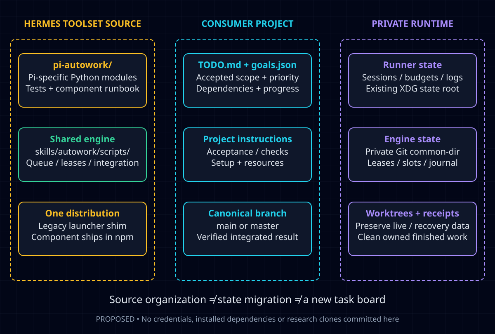

# Pi Autowork component layout

Status: Proposed. Research/planning only; no file migration or implementation is authorized by this document.

## User direction and scope

The user wants continued study of open-source orchestrators, comparison against our existing pipeline, and a coherent place for tooling belonging to the Pi Autowork runner. Pi performs heavy automated coding; the component remains part of Autowork. `TODO.md` and `goals.json` remain the project work queue and its synchronized index.

The requested name is interpreted as **Pi Autowork**. My reversible naming choice is `pi-autowork/` for the source component and `pi_autowork` for its Python import package.

This is a layout/refinement proposal for the existing [TOOLSET-115-bf coordinator redesign](https://github.com/TrebuchetDynamics/autowork/blob/0e6f67b1a7d49e59868885d3312bbe9bc91361ee/docs/plans/2026-10-16-pi-autowork-coordinator.md), not another redesign or a replacement task. The accepted design currently names `scripts/pi_autowork/`; changing that destination is proposed here and must not rewrite an active worker's assigned contract. The [reference study](../research/pi-autowork-reference-architectures.md) provides the reuse evidence.

## Recommendation

**Create one Pi-specific component inside the existing repository and package. Keep the generic Autowork engine shared. Keep runtime state out of source control.**

Do not put every related file into one undifferentiated directory. Ownership matters more than physical proximity: runner source, project intent, generic engine, installed dependencies and mutable runtime state have different lifecycles.

### Proposed source tree

```text
autowork/
├── pi-autowork/                    # Pi runner component; ships with Toolset
│   ├── README.md                   # component entry points and ownership map
│   ├── cli.py                      # tiny Python launcher; no task state
│   ├── pi_autowork/
│   │   ├── __init__.py
│   │   ├── cli.py                  # option parsing, status and exit-code contract
│   │   ├── coordinator.py          # reconcile/call engine; no second task FSM
│   │   ├── engine_client.py        # versioned calls to the shared engine
│   │   ├── pi_runtime.py           # launch/observe/stop/resume Pi; model fallback
│   │   ├── verification.py         # project checks and reviewer launch adapter
│   │   ├── touches_inference.py    # existing Pi-specific scope inference behavior
│   │   ├── workspaces.py           # Pi-session provisioning through engine APIs
│   │   ├── project_config.py       # existing CLI/environment normalization
│   │   ├── health.py               # read-only status projections and stall signal
│   │   └── service.py              # systemd rendering; changes only when requested
│   ├── tests/                     # component tests and controlled subprocess fixtures
│   └── docs/                      # component runbook and interface reference
├── scripts/pi-autowork.sh          # compatibility/discovery shim, not another loop
├── skills/autowork/scripts/        # shared scheduler, leases, slots, Git integration
├── skills/docs-sync/scripts/      # shared TODO/goals parsing and maintenance
├── adapters/pi.mjs                 # Pi command registration
├── package.json                    # one Toolset distribution includes pi-autowork/
└── docs/                           # product-level cross-host/planning/research docs
```

These are planned paths, not files created by this research. A new standalone package, second lockfile, framework, database or installer is not needed for the initial consolidation. If a Node runtime adapter is later justified, put its owned bridge in this component and declare it explicitly rather than silently discovering arbitrary extensions.

## Boundaries and ownership

| Kind | Owner/location | Must not become |
| --- | --- | --- |
| Accepted project intent | Consumer `TODO.md`, existing docs and `goals.json` | A per-worker replacement task board |
| Generic task lifecycle | Shared Autowork engine | A second Bash/Pi-component FSM |
| Pi execution mechanics | `pi-autowork/pi_autowork/` | Product/task acceptance authority |
| Agent skills/commands | Existing `skills/` and `adapters/` | Copies embedded in each consumer project |
| Shared execution lease/slots/journal | Existing Git-common-dir state | Tracked component files or reset migration output |
| Runner sessions/costs/logs/worktrees | Existing per-repository private state | Source files, vendored data or fresh budget on restart |
| Service environment | Existing user config for pi-autowork | Repository credentials or implicit fleet configuration |
| Pi credentials/models | Pi's existing host configuration | Copied credentials in this component |
| Upstream source-research snapshots | Private research storage | A vendor folder of entire third-party repositories |

Current defaults observed in the runner:

- State root: `${XDG_STATE_HOME:-~/.local/state}/pi-autowork`, or `PI_AUTOWORK_STATE_DIR`, with existing project-specific resolution preserved.
- Shared engine state: `<git-common-dir>/autowork-execution/`.
- User service config: `${XDG_CONFIG_HOME:-~/.config}/pi-autowork/<instance>.env`, or the current `PI_AUTOWORK_ENV_DIR` override.
- User unit: `pi-autowork@<instance>.service`, with existing instance-ownership checks.

A source reorganization must not relocate, empty or renumber any of those stores, change service identities, reset attempts/cost windows, or restart running workers. Two repositories with the same basename must not silently share an instance; preserve the existing refusal until a separately specified identity migration is qualified.



## Alternatives considered

1. **Leave everything under `scripts/`.** Least immediate path churn, but retains a large mixed shell implementation and no coherent component owner. Keep the legacy entry point, not the scattered implementation.
2. **Use the accepted `scripts/pi_autowork/` destination.** Technically sound and the lowest-risk option if that work has already landed. The top-level component provides a clearer home for source, tests and runbook. Do not stop active correctness work just to rename it; if it lands first, make the later move mechanical and compatibility-tested.
3. **Make a separate repository/npm package now.** Reject for this stage: it adds release/version/discovery ownership without removing the need for the shared Toolset engine.
4. **Adopt a complete external orchestrator.** Reject as the default: inspected projects often introduce another task store, role hierarchy, runtime requirements, publication path or cleanup policy.
5. **Move all generic Autowork code into Pi Autowork.** Reject: Pi is the worker host, not the owner of the cross-host task model.

## Migration plan — proposals, not executed work

### 1. Fix authority before moving files

Build on TOOLSET-115-bf's accepted lifecycle work and landed report-outcome changes. Record one authoritative state schema in the engine. Runtime events, model fallback and status UIs report observations; they cannot independently mark a task done.

Keep execution success, candidate verification, integration into a session, canonical delivery, metadata closure and cleanup distinguishable. Do not change the task lifecycle solely to make the directory tree tidier.

### 2. Extract one component with compatibility entry points

Move Pi-specific mechanics into the component, leaving generic admission, slots, claims, scope checks, integration and closure in the shared engine. `coordinator.py` calls engine operations and reconciles their observed results; it does not persist its own task-state enum/counters that compete with the engine.

Keep `scripts/pi-autowork.sh` as a small compatibility shim. Preserve all existing flags, exit codes, environment overrides, copied-launcher use and package discovery:

1. Honor an explicitly selected valid `PI_AUTOWORK_TOOLSET`.
2. Preserve the existing ability to locate the Toolset package Pi actually loads.
3. Preserve an adjacent source-checkout fallback when applicable.
4. Resolve component source, shared engine and skills from **one versioned Toolset root**; never mix two installed releases.
5. Carry the consumer repository separately from the Toolset source root; launching from an arbitrary working directory must not select the Toolset repository accidentally.

Do not invent a new Pi `list --json` contract: the current discovery reads supported `pi list` output. If discovery is later replaced, verify that CLI/API contract explicitly.

Existing services keep their current launcher and environment; the shim remains supported rather than imposing a forced migration deadline. Signals should reach a task-scoped persistent coordinator identity, not a transient launcher or shared gateway. Reusing a session or budget is not reusing an OS PID.

Safe updates need more than same-root discovery. For the controlled updater, fence the release used by the component and engine together; do not let a long-lived old coordinator call newly replaced engine files unnoticed. Defer an update while affected live, reported or integrating slots exist, including other runners sharing that installed release. Check state-schema compatibility before changing code, and keep the prior release usable on refusal/failure. At a compatible idle checkpoint, switch/re-exec component and engine as one release without resetting state or consuming attempts. An old monolithic copied launcher does not become a new shim merely because the package changed: preserve its supported engine contract or require an explicit safe-checkpoint launcher migration, with an actionable compatibility refusal rather than partial execution. External manual package replacement is not made atomic by this plan; detect mismatches before further admission.

### 3. Ship the whole component, not only the wrapper

The current root `package.json.files` includes `scripts/pi-autowork.sh` but no `pi-autowork/` directory. Add the component explicitly during implementation. A repository checkout passing tests is insufficient when the installed Pi archive omits its Python modules.

Explicitly move the behavior of `scripts/pi_autowork_touches.py` into `pi_autowork/touches_inference.py` and update all owned callers; retaining its old path is optional compatibility work, not a second implementation. The current archive omits this helper, and the inspected runner silently skips inference when it is absent. Test functional inference from the archive, not merely help/status: two independent tasks start without authored Touches, deterministic fake Pi proposes bounded paths, the helper/engine validates the proposals, and both become parallel-eligible. Also test inference disabled and missing/invalid inference: retain the conservative solo policy and make the diagnostic explicit rather than silently claiming full parallel behavior.

Keep one Toolset release. Run the component launcher directly from an extracted npm archive without checkout files, with paths containing spaces and a different cwd. Keep `adapters/pi.mjs` resource registration unchanged unless an explicit integration change requires it.

Add component tests to `scripts/check.py`'s maintained offline inventory. Merely placing tests under a new folder will not make the current four-directory inventory discover them. Keep a root legacy-launcher regression until all compatibility entry points are intentionally retired.

### 4. Qualify adoption and restart behavior

Reuse the existing fake-Pi/real-Git fixture pattern. Compare legacy and component entry points for arguments, environment, stdout/status schema, exit codes, default source/consumer selection and no-write dry-run behavior.

Exercise interrupted launch, live-worker adoption, cancellation escalation, stale report rejection, task reorder while workers run, exactly-once closure recovery and state-schema compatibility. In particular, separate live-process reuse from transcript persistence and same-process extension reload from crash recovery; test generation-fenced settlement and a cancellation arriving before spawn completes. Apply capacity globally to async calls and retained idle workers, use bounded RPC deadlines, and test process-group TERM-to-KILL escalation. Qualify the selected Pi version's `agent_end`/`agent_settled` events rather than treating either as task acceptance. Do not stop a production service or launch a model just to test a file move.

Add controlled old/new-release fixtures for installed and copied entry points: each busy-slot stage defers update; incompatible schema preserves the old usable release and explains refusal; compatible idle update switches component/engine together while retaining attempts, leases, budgets and receipts. Cover the unchanged old monolithic copy separately from a copied new shim, so re-executing an old file cannot masquerade as successful migration. These are proposed offline fixtures, not executed upgrade evidence.

A live disposable-project run and any service migration require their own explicit scope. Linux-only supervision does not become portable merely because code moved from Bash to Python.

### 5. Evaluate one upstream execution seam

Only after the current runtime boundary is stable, compare the existing Pi CLI adapter against a pinned execution-only candidate. AgwaB is a candidate, not a dependency decision. Its current automatic worktree finalization must remain outside our workflow; Toolset owns workspace retention and canonical integration.

First reuse upstream invariants and negative fixtures that expose a real gap. Copy only reviewed, licensed portions or use a narrow dependency interface. If no measured benefit justifies another runtime, keep the current CLI.

## Observable acceptance

The proposed migration is ready only when:

- Every Pi-specific source file has one component owner and every generic engine responsibility remains shared.
- Existing commands, copied launchers and service entry points continue to resolve one compatible Toolset release.
- The extracted distribution contains and runs the Python component, engine and required resources without checkout-only files.
- Archive-based inference with two independent missing-Touches tasks is observed; disabled/invalid inference remains conservatively solo with an explicit diagnostic.
- Installed and copied-launcher update fixtures prove busy/schema refusal and coherent idle release switching without losing state; a mixed-generation component/engine cannot admit work silently.
- `TODO.md`, `goals.json`, worker attempts, leases, session/candidate receipts, budgets and existing service configuration preserve their meanings and identities.
- No migration path resets/cleans the canonical or session checkout, deletes retained candidate evidence, resumes a paused job or restarts a live worker.
- Canonical delivery and eligible worktree removal are separately verified; active, dirty, unmerged, locked and recovery-bearing worktrees remain.
- New tests are in the canonical offline inventory and cover both old and new entry points.

Planned verification during implementation: `python3 scripts/check.py`, existing `tests/test_pi_autowork.py`, new component tests, `node --test tests/portable_pi.test.mjs`, extracted-archive execution tests, documented dry-run/status checks and shell syntax/lint for any remaining wrapper. These new migration tests were **not run** because the component has not been implemented.

## Risks and non-goals

- A “read-only linked dependency” is not made OS-read-only by a symlink. Retain the accepted setup policy, but specify actual enforcement or explicitly label the boundary cooperative; no implicit mount/sudo/permission change is authorized.
- The existing shell-string validation environment variable is trusted executable configuration. Preserve its behavior; a future argv-based configuration must not silently reinterpret it with `shlex.split` or shell expansion.
- Do not introduce automatic installers, global model/approval changes, external telemetry, another task board, a vendor dump, remote publication or fleet deployment.
- This plan does not suspend independent accepted fixes or force active workers to reread a changed contract mid-run.

## Handoff

Attach this research/layout refinement to **TOOLSET-115-bf**. Preserve that task's accepted phases and current owner, and do not reopen the completed PARALLEL goal. The local checkout was behind the upstream task/plan during this study; a targeted metadata proposal accompanies the research rather than overwriting a stale canonical backlog.

Implementation remains a separate next step. This document makes the proposed boundary and migration checks concrete; it does not claim the folder exists, an upstream runtime was adopted, or a service was migrated.
