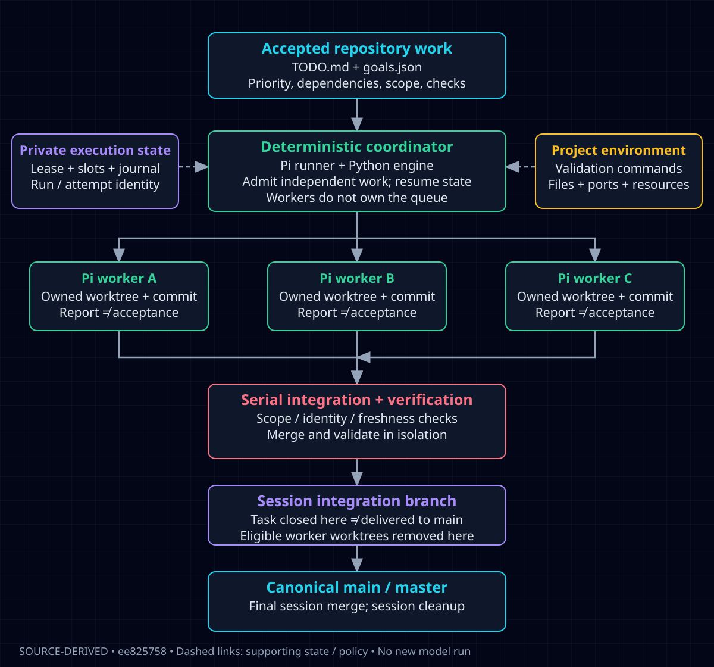
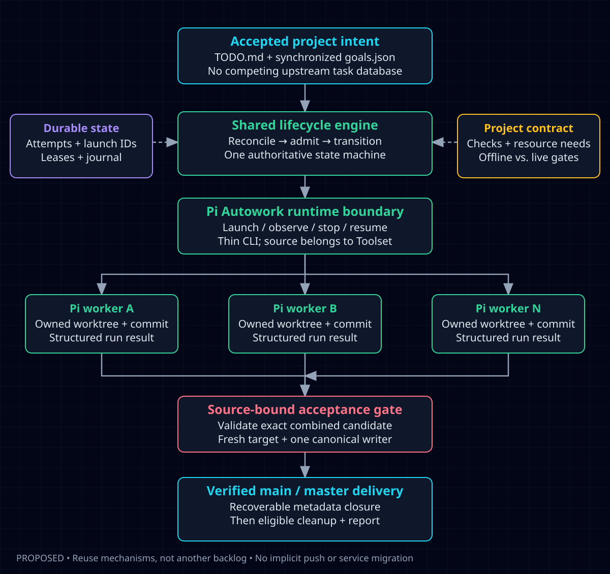

# Pi Autowork: open-source reference architectures

**Research snapshot:** 2026-10-16. **Scope:** research and planning, not implementation or installation.

## Decision brief

Keep Autowork's `TODO.md` → `goals.json` → deterministic coordinator pipeline. Reuse execution, recovery and verification mechanisms underneath it; do not replace it with another project's task board, role hierarchy or PR workflow.

**Closest overall architectural reference: Overstory.** It combines agent-runtime adapters, isolated workspaces, persistent sessions, a merge queue and supervision. Its Pi adapter is explicitly experimental, and several merge/recovery policies differ from ours. It is a reference, not a recommended drop-in installation.

**Closest small Pi execution-runtime candidate: AgwaB/pi-subagent.** It exposes run/status/wait/interrupt/reconcile APIs and separates durable runs from attempts without requiring a new backlog. If evaluated, Toolset should create and retain the worktrees and pass their CWD into the runtime. Its built-in success cleanup is incompatible with our keep-unmerged-work policy.

**Best coordinator specification: Symphony.** Borrow its reconcile-before-dispatch loop and distinction between a successful worker run and an accepted task. Keep our durable journal; Symphony intentionally reconstructs rather than restores its exact in-memory scheduler state.

**Best complementary mechanisms:** Agent Orchestrator's launch/revision fencing, MinhDuyDEV's resource-claim generations and separate proof phases, pi-rukas's host budgets and process-tree cancellation, and Gas Town's exact submitted-head checks.

These are source-based engineering judgments, not performance rankings. No reviewed system has been demonstrated in this study to satisfy our whole pipeline unchanged.

## Evidence and boundaries

The study investigated **17 distinct project leads**. The initial wave screened 13 repositories; the follow-up added four projects named `pi-orchestrator`. Implementation evidence was obtained for **16**: 15 pinned Git source trees and one checksum-verified published npm build. The remaining project's implementation is unavailable. The accompanying [source catalog](pi-autowork-sources.json) keeps these evidence classes separate; a publisher's unverified `gitHead` is not counted as a verified Git revision.

Core modules and selected tests were read, not executed. No external project was installed, no upstream scripts/models were run, and no production worker, service, schedule, credential or task contract was changed. “A test exists” does not mean it passed. Repo descriptions and search results were leads, not implementation evidence.

The local comparison baseline is [`ee825758`](https://github.com/TrebuchetDynamics/autowork/tree/ee82575878bb115f4b06d6f7d9b01029ab008790). During research, the existing [TOOLSET-115-bf coordinator redesign](https://github.com/TrebuchetDynamics/autowork/blob/0e6f67b1a7d49e59868885d3312bbe9bc91361ee/docs/plans/2026-10-16-pi-autowork-coordinator.md) and its [phase-1 report-outcome change](https://github.com/TrebuchetDynamics/autowork/commit/59a44cf1de210c3ea0c5d8a98e019ea580ecfe08) appeared upstream. The research supports that work; it must not create a competing redesign or reopen completed parallel-worker tasks. Observations about the pinned baseline are not claims that later revisions still contain every issue.

## 1. The problem we actually need to solve

A subagent launcher answers “how do I run another model?” Our product needs more:

1. Accepted, ordered repository tasks remain in one human-readable queue and its synchronized index.
2. Independent tasks run concurrently; overlapping files, shared resources and dependencies do not.
3. Restart and cancellation preserve task, attempt, process, workspace and candidate identity.
4. A worker's message or exit is evidence of execution, not acceptance.
5. Verification checks the exact combined candidate against a fresh target.
6. One owner advances canonical `main` or `master`; no push is implied.
7. Finished owned worktrees disappear only after the relevant integration and preservation checks. Live, dirty, unmerged or recovery-bearing work stays.
8. Different project languages use the same control plane but supply their own setup, validation, resources and live-operation restrictions.

Do not equate a generic coding agent, a chat room, a best-of-N verifier or a Kanban UI with this complete lifecycle.

## 2. What we already have



The current implementation already has meaningful orchestration rather than just prompt loops:

- `parallel_plan.py`: pure dependency/path/resource admission, including glob overlap and serial handling for manifests, schemas and CI files.
- `parallel_state.py`: coordinator ownership, slots, attempts, identities and journaled transitions.
- `parallel_dispatch.py`: worktree provisioning, bounded workers, resource admission, waiting and timeouts.
- `parallel_integrate.py`: report/source/scope validation, isolated merge verification, fresh-target promotion, closure and worker cleanup.
- `pi-autowork.sh`: Pi launch, fallback, reported-cost/runtime budgets, signals, service management and session-to-main integration.

The important architectural weakness is **split lifecycle authority**: Bash keeps another model of state around the Python engine. TOOLSET-115-bf already addresses that, so the recommended improvement is consolidation, not a second orchestration framework.

The baseline also has two integration levels: the engine closes tasks on a session integration branch; the runner later delivers that branch to canonical main. A display that says “closed” must not imply “already on canonical main.” Represent these delivery stages explicitly.

The private, code-only Graphify map covered eight pinned local files, with 336 nodes and 1,037 edges. It helped locate the control boundaries; direct source reads corroborated them. This is not full-repository graph coverage or runtime qualification.

## 3. Reference comparison

| Reference | Useful contribution | Mismatch with our pipeline | Decision |
| --- | --- | --- | --- |
| [Overstory](https://github.com/jayminwest/overstory/tree/ff38f3f76f084abcc34f519bcaa69580f6e53cf1) | Runtime adapter, worktree/session/merge-queue architecture | Seeds/Beads ecosystem, experimental Pi adapter, permissive recovery/conflict heuristics | Closest overall reference; adapt interfaces |
| [AgwaB/pi-subagent](https://github.com/AgwaB/pi-subagent/tree/ab91a74fcbd079caa27f9e48932004d1fd9c1e9f) | Narrow execution API, run/attempt identity, process-birth checks | Built-in success cleanup can remove pre-integration worktrees | Best execution-only evaluation candidate |
| [Symphony](https://github.com/openai/symphony/tree/be10a1b79df723d6d7612b5651c8522704dafb2e) | Clear scheduling/reconciliation/acceptance boundaries | Tracker/Codex assumptions; exact scheduler maps not durable | Borrow specification and invariants |
| [Agent Orchestrator](https://github.com/OrchestratorInc/agent-orchestrator/tree/c228b96f29fb86acdaf58001f0bc52a71c54e998) | Launch generation + revision fences, startup reconciliation | Go daemon/desktop/SQLite/session architecture is much larger | Adapt small lifecycle contracts |
| [MinhDuyDEV/pi-subagents](https://github.com/MinhDuyDEV/pi-subagents/tree/6df61535ec2f9d580c2a687014cfb585eb7e44bf) | Fenced claims, durable execution/verification/review phases | Herdr/core coupling; pinned Pi peer range excludes 1.x | Reuse concepts/test cases, not install unchanged |
| [pi-rukas](https://github.com/trail-openers/pi-rukas/tree/a3dd722bc876273577ea490f72f8600f62421610) | Host-aware budgets, cancellation, workstream planning | PR/push-oriented driver; integration lock has fail-open branches | Selective budget/process patterns |
| [Gas Town](https://github.com/gastownhall/gastown/tree/649b832b7672bc7a2dbef26f5983aba6198b819b) | Pure dispatch planning, submitted-head and merge proof | Beads and role hierarchy; remote-push proof conflicts with no-push default | Adapt local proof boundary |
| [nicobailon/pi-subagents](https://github.com/nicobailon/pi-subagents/tree/f8ada81303db6ee76ed22fee5605dc8a8d62a83a) | Rich delegation API, capability ceilings, reviewed cleanup planning | Large SDK/workflow/mission surface; other cleanup paths allow patch-preserved deletion | Selective contract and test reuse |
| [pi-messenger](https://github.com/nicobailon/pi-messenger/tree/09937ed647a1b07a3b595bf75943feacb80ff123) | Communication, readiness validation, progress UI | Crew task store is another authority; inspected workers share CWD; dependencies can be advisory | Presentation/coordination patterns only |
| [RielJ/pi-git-worktrees](https://github.com/RielJ/pi-git-worktrees/tree/e24a6bb17dc5a8dcd50403e4cb719895e97c0d55) | Interactive worktree sessions and heartbeat UI | Current-branch merge without our gates, then aggressive cleanup | UI inspiration; not lifecycle implementation |
| [edxeth/pi-subagents](https://github.com/edxeth/pi-subagents/tree/cf6dbf41c17986f3882e6804a68e8fb8282d25e6) | Exact winner-tree gate and receipt-backed adoption | Best-of-N alternatives for one task, not independent-task fan-in | Secondary verification reference |
| [Claude Squad](https://github.com/smtg-ai/claude-squad/tree/ce1ffb4392b01f38e2c4599c7c84d2a93973b138) | Multi-program terminal/worktree UX | Interactive session manager; AGPL copying requires different license analysis | Screen, not core reuse |
| [Vibe Kanban](https://github.com/BloopAI/vibe-kanban/tree/d5cbb5380fa0b32e98ef9b8d987f63decce4be3a) | Multi-executor/workspace application | Board/web/DB authority; pinned README announces sunsetting | Screen, not replacement |

Names drift: ComposioHQ/agent-orchestrator now resolves to **OrchestratorInc/agent-orchestrator**; randomm/pi-ensemble to **trail-openers/pi-rukas**; steveyegge/gastown to **gastownhall/gastown**. Current Agent Orchestrator source is Go/desktop, not the historical TypeScript plugin layout described in older articles. GitHub API redirects were independently rechecked.

## 4. What to reuse, specifically

### Runtime adapter: Overstory + AgwaB

Overstory's [`AgentRuntime`](https://github.com/jayminwest/overstory/blob/ff38f3f76f084abcc34f519bcaa69580f6e53cf1/src/runtimes/types.ts#L158-L265) separates launch/config/readiness/transcript capabilities. Start with a smaller Python boundary: `launch`, `observe`, `stop`, `resume`, capabilities and normalized events. Continue using the existing Pi CLI until an alternative proves a concrete benefit.

AgwaB's [`runSubagent` API](https://github.com/AgwaB/pi-subagent/blob/ab91a74fcbd079caa27f9e48932004d1fd9c1e9f/src/api.ts#L263-L336) is the plausible dependency seam. Pass a Toolset-owned worker worktree as its CWD; do not ask it to create/finalize that worktree. Its headless/process backend is a better isolation match than inline SDK sessions. This needs an adapter spike and Pi-version qualification, not immediate adoption.

### Stale-result protection: Agent Orchestrator + AgwaB

Agent Orchestrator's [`ActivitySignal`](https://github.com/OrchestratorInc/agent-orchestrator/blob/c228b96f29fb86acdaf58001f0bc52a71c54e998/backend/internal/ports/runtime_observations.go#L41-L88) carries expected revision and launch identity. AgwaB's [`commitAttemptResultIfActive`](https://github.com/AgwaB/pi-subagent/blob/ab91a74fcbd079caa27f9e48932004d1fd9c1e9f/src/artifacts/registry.ts#L961-L990) refuses stale attempts under a lock. These are stronger than matching a task name or accepting the last message written.

First compare these against our existing identity and attempt guards. Reuse their adversarial scenarios before adding duplicate infrastructure. A launch token is not an OS process-birth check; both solve different races.

### Resource ownership: MinhDuyDEV

[`ResourceLease` and transfers](https://github.com/MinhDuyDEV/pi-subagents/blob/6df61535ec2f9d580c2a687014cfb585eb7e44bf/src/orchestration/claims.ts#L256-L340) bind owner changes to an expected generation and issue a fresh fence. Adapt the vocabulary to our existing `Resources:` and slots rather than importing a second lease store. A fence only protects write paths that actually check it; it is not a shell sandbox.

Do not port corrupt-store recovery unchanged: resetting an authority store while old writers survive can reuse generations. Preserve/quarantine and stop affected admission until ownership is reconciled.

### Scheduling semantics: Symphony + Gas Town

Symphony's [run-success boundary](https://github.com/openai/symphony/blob/be10a1b79df723d6d7612b5651c8522704dafb2e/SPEC.md#L36-L58) explicitly allows handoff without task completion. Its [reconcile/retry ordering](https://github.com/openai/symphony/blob/be10a1b79df723d6d7612b5651c8522704dafb2e/SPEC.md#L780-L839) is a useful review checklist for TOOLSET-115-bf.

Gas Town's [`BlockerAware`](https://github.com/gastownhall/gastown/blob/649b832b7672bc7a2dbef26f5983aba6198b819b/internal/scheduler/capacity/pipeline.go#L101-L144) and [`RunPlan`](https://github.com/gastownhall/gastown/blob/649b832b7672bc7a2dbef26f5983aba6198b819b/internal/scheduler/capacity/dispatch.go#L117-L169) make plan, dispatch and post-launch bookkeeping distinct. “Launch happened but receipt write failed” must become reconciliation, not blind redispatch.

### Budgets and shutdown: pi-rukas

[`readHostResources` / `budgetFor`](https://github.com/trail-openers/pi-rukas/blob/a3dd722bc876273577ea490f72f8600f62421610/extension/src/host-resources.ts#L79-L144) and [`killProcessTree`](https://github.com/trail-openers/pi-rukas/blob/a3dd722bc876273577ea490f72f8600f62421610/extension/src/spawn-kill.ts#L39-L105) are bounded reuse targets. Separate model-worker slots, expensive test slots, memory estimates and persistent cost/runtime budgets. Cgroup detection is useful input, not proof of hard spend or memory enforcement.

## 5. Behaviors we must not copy blindly

- **Premature cleanup:** AgwaB's [`finalizeWorktreeResult`](https://github.com/AgwaB/pi-subagent/blob/ab91a74fcbd079caa27f9e48932004d1fd9c1e9f/src/workspace/worktree.ts#L223-L269) captures artifacts then force-removes completed worktrees. Its [diff against HEAD](https://github.com/AgwaB/pi-subagent/blob/ab91a74fcbd079caa27f9e48932004d1fd9c1e9f/src/workspace/worktree.ts#L168-L193) does not by itself capture worker-created commits. That is not equivalent to canonical integration.
- **Fail-open integration locks:** pi-rukas's [`acquireLockfile`](https://github.com/trail-openers/pi-rukas/blob/a3dd722bc876273577ea490f72f8600f62421610/extension/src/work-driver-lock.ts#L46-L108) explicitly proceeds on some lock failures/timeouts. A local promise chain cannot serialize another process or another worktree.
- **Guessed completion:** Overstory's watchdog has an [assumed-completed path](https://github.com/jayminwest/overstory/blob/ff38f3f76f084abcc34f519bcaa69580f6e53cf1/src/watchdog/health.ts#L280-L309). A dead PID and old heartbeat cannot establish our task acceptance.
- **Another backlog:** Messenger Crew persists its own task/plan files; its [readiness helper](https://github.com/nicobailon/pi-messenger/blob/09937ed647a1b07a3b595bf75943feacb80ff123/crew/store.ts#L479-L492) can bypass dependencies in advisory mode. Derived execution requests are fine; competing task authority is not.
- **Unsafe universal command inference:** pi-rukas's `.pi/verify-cmd` is useful explicit configuration, but its [fallback command inference](https://github.com/trail-openers/pi-rukas/blob/a3dd722bc876273577ea490f72f8600f62421610/extension/src/work-driver-verify-cmd.ts#L241-L282) is not a general acceptance engine for every project.
- **Hidden publication:** Gas Town's post-merge proof includes [pushed-origin target reachability](https://github.com/gastownhall/gastown/blob/649b832b7672bc7a2dbef26f5983aba6198b819b/internal/refinery/engineer.go#L1538-L1559). Adapt it to verified local target reachability unless publication was separately authorized.

These are differences in inspected code/policy, not a claim that each upstream project is universally unsafe.

## 6. Recommended mental model



```text
Accepted intent: TODO.md + goals.json
                 |
Deterministic engine: reconcile → eligibility → reserve → launch
                 |                    |
          durable attempts       Pi runtime adapter
                 |                    |
          candidate reports ← isolated Pi workers
                 |
Evidence gate: report + exact candidate + project checks
                 |
Single canonical writer: validate combined tree → promote main/master
                 |
Recoverable metadata closure → eligible cleanup → report
```

LLMs investigate, implement and review. Code owns lifecycle transitions, locks, retries, admission and commit/ref identity. Neither a completion marker nor a chat summary gets to advance the authoritative task by itself.

A session integration branch may remain an optimization, but its state must be explicitly different from canonical delivery. Recommended reporting dimensions are execution, verification, integration, closure and cleanup. This is a design proposal to review with TOOLSET-115-bf, not a new implemented state schema.

## 7. “Any project” means configurable acceptance

The control plane can be language-neutral. Project behavior cannot be guessed universally. Each project needs:

- Its canonical repository identity and target branch.
- Accepted task bodies and dependencies.
- Explicit validation commands, cwd, allowed environment and timeout.
- Resources beyond files: ports, databases, devices, exclusive environments and expensive build capacity.
- An explicit setup policy; do not install dependencies or execute discovered hooks without the relevant authority.
- A clear split between offline acceptance and pending live/device/production checks.

Keep project-specific facts in its existing instructions/configuration and pass a normalized descriptor to the same coordinator. Do not add a new task file or board per framework. Worktrees isolate Git working directories, not credentials, services, network, tools or arbitrary shell writes. Current Linux process supervision is not cross-platform qualification.

## 8. File organization and adoption plan

The companion [component-layout proposal](../plans/pi-autowork-component-layout.md) recommends one `pi-autowork/` component inside Autowork, containing Pi-specific coordinator/runtime code, tests and local documentation. Generic queue/admission/integration code remains shared under Autowork. Runtime state, worktrees, credentials and source-research clones do not move into that component.

A skeptical builder review identified two acceptance gaps, now added to the proposal: coherent old/new-release switching for installed and copied launchers, and functional archive tests for the currently omitted Touches-inference helper. These are specification corrections, not implemented fixes or a new passing runtime test result.

Follow this order:

1. Reuse TOOLSET-115-bf and its already accepted lifecycle/safety work; do not create another coordinator project.
2. Specify the tiny runtime boundary and state/evidence ownership before moving files.
3. Consolidate Pi-specific source with a legacy launcher shim, explicit package inventory and archive-based compatibility tests.
4. Reuse upstream tests/invariants where they cover actual gaps. Port a small licensed module or evaluate one execution adapter only after the current CLI baseline is measured.
5. Keep the existing default until a controlled fixture and an authorized live disposable-project run demonstrate a benefit without weakening recovery, acceptance, no-push or cleanup.

No new runtime dependency is selected merely because it is popular or implements a similarly named feature.

## 9. Follow-up: four Pi orchestrators

### Kyle Boas: reusable live RPC workers

[kyleboas/pi-orchestrator](https://github.com/kyleboas/pi-orchestrator/tree/7671d84c1f19f4bc52b43c15bfab3ae17b6a1bee) is the most relevant additional reference for a **reusable live worker**. Its [generation-guarded lifecycle](https://github.com/kyleboas/pi-orchestrator/blob/7671d84c1f19f4bc52b43c15bfab3ae17b6a1bee/extensions/orchestrator-lib/worker-lifecycle.ts#L82-L159) separates starting, settling, reporting and steering. This is a concrete contract worth testing in our runtime adapter.

Important limits: workers [disable disk sessions](https://github.com/kyleboas/pi-orchestrator/blob/7671d84c1f19f4bc52b43c15bfab3ae17b6a1bee/extensions/orchestrator-lib/orchestrator-core.ts#L79-L84); the global runtime survives extension reload in the **same parent process**, not a host crash. Idle live workers still consume its process limit. Its inspected termination helper sends TERM to the process group/direct child but has no KILL escalation. It accepts both `agent_end` and `agent_settled`; that is this extension's compatibility policy, not proof of universal Pi event semantics. Actual MIT license text was inspected.

### Saify Matteo: linked transcripts, not persistent workers

[saifymatteo/pi-orchestrator](https://github.com/saifymatteo/pi-orchestrator/tree/3f14476a0bba9ac0483247a3d687890981cbf2e3) has useful cancellation/late-spawn races and parent-tool gating. However, [children are killed at `agent_settled`](https://github.com/saifymatteo/pi-orchestrator/blob/3f14476a0bba9ac0483247a3d687890981cbf2e3/src/delegate.ts#L1571-L1578): transcript persistence must not be advertised as reusable workers or restart adoption.

Its [default async fan-out](https://github.com/saifymatteo/pi-orchestrator/blob/3f14476a0bba9ac0483247a3d687890981cbf2e3/src/delegate.ts#L2418-L2467) bypasses the limiter used by its blocking branch. Our admission must therefore apply across async calls and retained idle workers, not just within one invocation. The inspected manifest declares MIT but the pinned tracked tree has no license grant text; copying remains a license-evidence gate. Its process killer targets the direct child, so descendant cleanup is not established.

### Trader Payne: published implementation recovered

The GitHub repository returns 404. The implementation was recovered as [npm `pi-orchestrator@1.1.1`](https://registry.npmjs.org/pi-orchestrator/-/pi-orchestrator-1.1.1.tgz), with tarball SHA-1 verified as `5d8e7da827feff7a2d80ed45949009f911b9fc6d`. Its publisher-declared `gitHead` is not independently verified and must not be presented as a source-tree pin.

The [phase engine](https://unpkg.com/pi-orchestrator@1.1.1/dist/src/workflow/engine.js) and dispatch/recovery module separation are useful organization references. But its generated Messenger task authority competes with ours. [`isCrewComplete`](https://unpkg.com/pi-orchestrator@1.1.1/dist/src/dispatch/crew-shared.js) can consider settled blocked tasks terminal; [`cleanCrewState`](https://unpkg.com/pi-orchestrator@1.1.1/dist/src/dispatch/crew-runner.js) deletes shared Crew task/planning files without our ownership/idleness/merge checks. No canonical source-bound merge protocol was demonstrated. Actual MIT text exists in the published package; no upstream tests were available in it to inspect.

### Rayshawn McCall: unavailable, not ranked

The exact `rayshawnmccall21/pi-orchestrator` repository returns 404; alternate source/archive searches did not recover an implementation. Event-bus/worktree/merge descriptions remain unverified. This is an acquisition limit, not proof that the advertised mechanisms do not exist. No license or code-reuse recommendation can be established, and it does not affect the completed comparison of accessible projects.

### Concrete adapter checks added by this wave

- Separate live-process reuse, persistent transcripts, extension reload survival and crash/restart adoption in the runtime capability record.
- Register an attempt before spawning; cancellation during spawn must terminate a late-created process without delivering stale success.
- Generation-fence settlement, correction and reporting; an old final-text response must not complete a new assignment.
- Apply global capacity to asynchronous submissions and retained idle workers; support explicit idle release/eviction.
- Qualify `agent_end`/`agent_settled` semantics against the actual pinned Pi runtime; neither event establishes acceptance.
- Persist the terminal receipt independently from chat delivery. Add bounded RPC timeouts and process-group TERM-to-KILL escalation tests.

These findings refine the existing adapter boundary; none justifies replacing our queue or importing a whole orchestrator.

## Fixture coverage (TOOLSET-116-c1)

The stale-result and cancellation scenarios above are now offline fixtures in
`skills/autowork/scripts/test_parallel_adversarial.py`, with controlled subprocess
workers (`fixtures/fake_worker.py`). Only scenarios were ported; no upstream code.

| Scenario | Mirrors | Before | Now |
|---|---|---|---|
| Late report from a superseded attempt arrives after the retry committed without one | AgwaB `commitAttemptResultIfActive`; Kyle Boas old final text | already covered: reports are read per attempt and must match the commit | fixture |
| Paused attempt resumes; its earlier report must not stand in | AgwaB generation guard | already covered: the resumed attempt's report is removed | fixture |
| Launch happened but recording the worker failed | Gas Town `RunPlan`; Saify Matteo cancellation during spawn | **gap**: the next pass started a second worker in the same worktree | fixed |
| A child that left the worker's process group survives the timeout stop | Kyle Boas TERM without KILL; pi-rukas `killProcessTree` | **gap**: it kept running and could write into the worktree the retry reuses | fixed |
| Worker exits while a descendant in another session still writes | Agent Orchestrator `ActivitySignal` | **gap**: the slot was reported while the descendant was writing | fixed |
| Later task finishes first; both land exactly once | Symphony reconcile-before-dispatch; AgwaB out-of-order completion | already covered | fixture |
| Coordinator dies mid-task; the worker reports to a new coordinator | Gas Town reconciliation; Agent Orchestrator launch identity | already covered: the live worker is adopted, no attempt spent | fixture |

The three gaps had one cause: liveness came only from the recorded leader and its
process group. Every worker now inherits `AUTOWORK_WORKTREE=<worktree>`;
`parallel_state.worker_live` also counts any live process carrying that marker, and
`parallel_dispatch.stop` signals those processes as well as the group, escalating
from SIGTERM to SIGKILL. A process that clears its environment is still invisible:
the marker narrows the race, it is not a sandbox.

## 10. Licensing and confidence

- MIT references permit reuse subject to preserving the copyright/permission notice for copies or substantial portions.
- Apache-2.0 references require license/attribution handling, applicable NOTICE preservation and marking modified files; review component-specific notices and dependencies too.
- Claude Squad is AGPL-3.0. Do not copy it into a differently licensed coordinator as if it were MIT; separate legal/compatibility analysis is required.
- Messenger declares MIT in package metadata, but this snapshot has no tracked LICENSE grant and GitHub detected none. Treat code-copying permission/notice as unresolved, not automatically equivalent to an inspected MIT LICENSE.
- MinhDuyDEV's inspected peer range is `>=0.84.0 <0.85.0`, which does not claim compatibility with the Pi 1.x line in our existing qualification record. AgwaB's wildcard peers likewise are not a compatibility test.

Confidence is high for the cited source branches and explicit license texts; moderate for comparative fit; unqualified for live upstream performance, production robustness, OS isolation and compatibility with our exact installed Pi. No throughput or reliability claims were benchmarked in this study.

## Proposed follow-up boundaries

Keep follow-ups attached to the existing coordinator redesign. The recommended first experiment is not a whole-framework adoption: compare the existing Pi CLI adapter with one execution-only adapter behind the same contract, using identical fixtures for cancellation, restart adoption, stale results, out-of-order completion, combined-tree verification and cleanup retention. Record any compatibility failure rather than weakening the contract.

This research does not approve code reuse, a file migration, a service restart, publication or fleet rollout. Those remain separate implementation/operational decisions.
